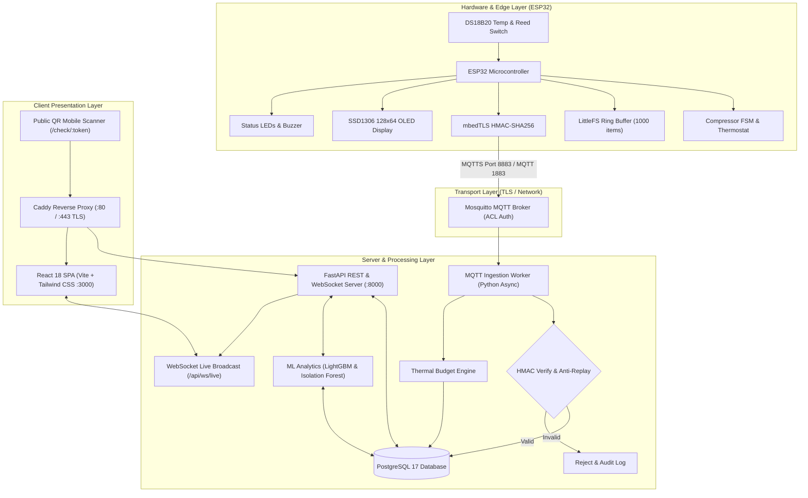
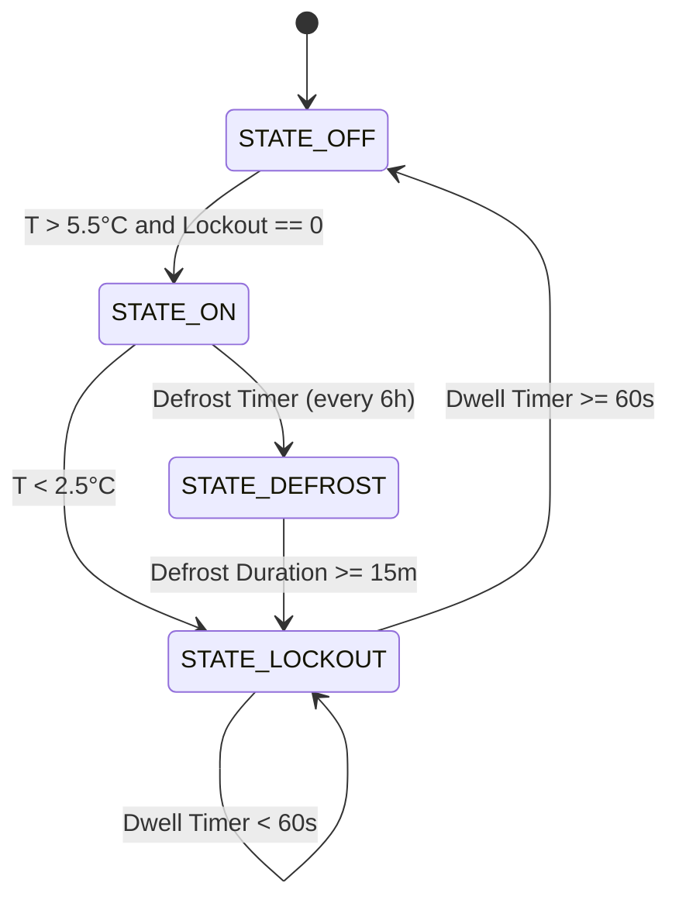
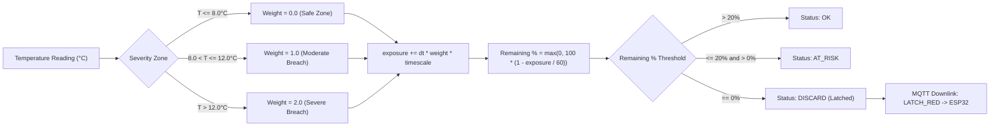
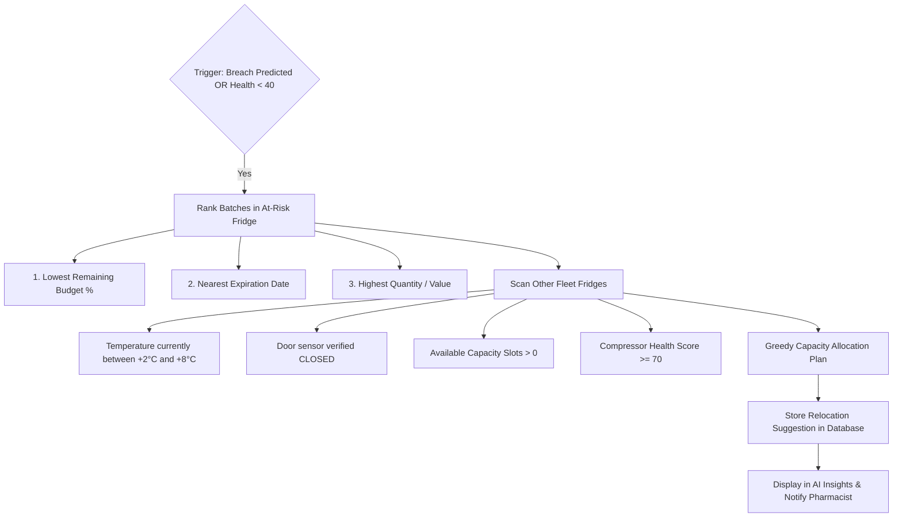

# ColdChain — Complete System Documentation & User Manual
## IoT Telemetry Hub: Enterprise Cold-Chain Monitoring Platform

**Document Version:** 2.0  
**Target Audience:** Pharmacists, System Administrators, Field Technicians, Compliance Inspectors  
**Last Updated:** October 2026  
**Repository Branch:** `BUBT_IOT_HACKATHON`  

---

## Table of Contents

1. [Executive Summary & System Architecture](#1-executive-summary--system-architecture)
2. [Physical Hardware & ESP32 Firmware Logic](#2-physical-hardware--esp32-firmware-logic)
   - [Hardware Specification](#hardware-specification)
   - [Compressor Finite State Machine (FSM)](#compressor-finite-state-machine-fsm)
   - [Thermal Physics Model](#thermal-physics-model)
   - [Offline Ring-Buffer Resilience](#offline-ring-buffer-resilience)
   - [Cryptographic Telemetry Signing & Anti-Replay](#cryptographic-telemetry-signing--anti-replay)
   - [MQTT Downlink Command Protocol](#mqtt-downlink-command-protocol)
3. [Step-by-Step: Adding and Provisioning a New Device](#3-step-by-step-adding-and-provisioning-a-new-device)
   - [Step 1: Mosquitto MQTT Credentials & ACLs](#step-1-mosquitto-mqtt-credentials--acls)
   - [Step 2: Pre-Shared Key (PSK) Registration](#step-2-pre-shared-key-psk-registration)
   - [Step 3: Firmware Configuration & Flashing](#step-3-firmware-configuration--flashing)
   - [Step 4: Admin Portal Device Registration](#step-4-admin-portal-device-registration)
   - [Step 5: Fridge Creation and Device Pairing](#step-5-fridge-creation-and-device-pairing)
   - [Step 6: Commissioning & Handshake Verification](#step-6-commissioning--handshake-verification)
4. [Mathematical & Algorithmic Engine Specifications](#4-mathematical--algorithmic-engine-specifications)
   - [Heat-Exposure Budget Engine](#heat-exposure-budget-engine)
   - [Mean Kinetic Temperature (MKT) Calculation](#mean-kinetic-temperature-mkt-calculation)
   - [30-Minute Temperature Forecasting (LightGBM)](#30-minute-temperature-forecasting-lightgbm)
   - [Compressor Health Scoring (Isolation Forest)](#compressor-health-scoring-isolation-forest)
   - [Automated Vaccine Relocation Optimizer](#automated-vaccine-relocation-optimizer)
   - [Cryptographic Audit Hash Chain](#cryptographic-audit-hash-chain)
5. [Role-Based Access Control (RBAC) & Permissions](#5-role-based-access-control-rbac--permissions)
6. [Operator User Guide & Dashboard Walkthrough](#6-operator-user-guide--dashboard-walkthrough)
   - [Authentication & Session Handling](#authentication--session-handling)
   - [Fleet Dashboard (`/app`)](#fleet-dashboard-app)
   - [Fridges Management & Detail (`/app/fridges`)](#fridges-management--detail-appfridges)
   - [Vaccine Batch Inventory & QR Generation (`/app/inventory`)](#vaccine-batch-inventory--qr-generation-appinventory)
   - [Public QR Integrity Verification (`/check/:token`)](#public-qr-integrity-verification-checktoken)
   - [Alert Management & Triage (`/app/alerts`)](#alert-management--triage-appalerts)
   - [AI Insights & Predictive Analytics (`/app/ai`)](#ai-insights--predictive-analytics-appai)
   - [Cryptographic Audit Log Verification (`/app/audit`)](#cryptographic-audit-log-verification-appaudit)
   - [System Administration Portal (`/app/admin`)](#system-administration-portal-appadmin)
7. [Routine Maintenance, Backup & Disaster Recovery](#7-routine-maintenance-backup--disaster-recovery)
8. [Comprehensive API Reference](#8-comprehensive-api-reference)

---

## 1. Executive Summary & System Architecture

The **ColdChain IoT Telemetry Hub** is a mission-critical cold-chain monitoring system engineered to guarantee the viability of vaccines, biological medicines, and thermal-sensitive pharmaceuticals. The platform adheres to **WHO (World Health Organization) PQS E006** cold-chain equipment requirements and **USP (United States Pharmacopeia) Chapter <1079>** guidelines.

### High-Level Architecture



### Core Data Entities

1. **Device (`devices`):** A physical hardware unit (ESP32) with a unique MAC or serial ID, holding pre-shared cryptographic keys.
2. **Fridge (`fridges`):** A logical storage chamber or refrigeration unit with designated capacity slots, physical location, and bound to a Device.
3. **Batch (`batches`):** A consignment of specific vaccines (e.g., `Measles-Rubella`, `BCG`, `COVID-19 mRNA`) with quantity, expiry date, manufacturer info, unique public QR token, and an accumulated thermal exposure budget.
4. **Reading (`readings`):** An immutable, time-stamped telemetry point containing temperatures, compressor state, door status, power rail readings, and sequence numbers.
5. **Audit Record (`audit_log`):** An append-only cryptographic ledger where each record hashes the previous hash, creating a tamper-evident chain.

---

## 2. Physical Hardware & ESP32 Firmware Logic

The edge firmware is implemented in C++ for the ESP32 dual-core microcontroller (`firmware/coldchain/coldchain.ino`).

### Hardware Specification

| Component | Pin / Bus | Specification | Function |
|---|---|---|---|
| **MCU** | Onboard | ESP32-WROOM-32 (240 MHz, 520 KB SRAM, 4 MB Flash) | Main computing unit |
| **Primary Temp Sensor** | `GPIO 4` (1-Wire) | Maxim DS18B20 (±0.5°C accuracy, 12-bit resolution) | Internal chamber temperature |
| **Simulated Ambient** | Internal / ADC | Thermal Leakage Simulation Core | Calculates external thermal load |
| **Door Sensor** | `GPIO 13` (Pullup) | Magnetic Reed Switch (Active LOW) | Door open / close detection |
| **Compressor Relay** | `GPIO 27` (Output) | 5V Optocoupled Relay / SSR (Active HIGH) | Compressor power cycling |
| **OLED Display** | `GPIO 21` (SDA), `22` (SCL) | SSD1306 0.96" I2C OLED (128×64) | 3-page local technician UI |
| **Status LEDs** | `GPIO 16` (Green), `17` (Yellow), `18` (Red) | 3× 5mm LEDs with current-limiting resistors | Visual safety state |
| **Audible Alarm** | `GPIO 19` (PWM) | Active Piezo Buzzer (2.7 kHz resonant) | Critical breach & discard alarm |
| **Hardware WDT** | System Timer | ESP32 Hardware Watchdog (8-second timeout) | Self-recovery on firmware deadlock |

---

### Compressor Finite State Machine (FSM)

Refrigeration compressors must never be short-cycled. Rapidly turning a compressor on and off against high head pressures will overheat the motor windings, trip thermal overloads, and cause mechanical failure.

The firmware implements a **4-state Moore Finite State Machine**:



#### State Definitions
1. **`STATE_OFF`:** Compressor relay de-energized. Chamber warming naturally due to ambient leakage.
2. **`STATE_ON`:** Compressor relay energized. Active cooling applied. Pull-down rate approximately $0.3^\circ\text{C} - 0.5^\circ\text{C}/\text{min}$.
3. **`STATE_LOCKOUT`:** Mandatory anti-short-cycle dwell. Relay is locked `OFF`. Even if the temperature spikes above $+5.5^\circ\text{C}$ (e.g. door opened), the compressor **will not start** until `lockout_timer >= 60 seconds`.
4. **`STATE_DEFROST`:** Evaporator heating/dwell phase to clear ice buildup. Triggered every 6 hours of cumulative run time for a duration of 15 minutes.

---

### Thermal Physics Model

For testing and demonstration without a physical environmental chamber, the firmware incorporates a real-time thermal model:

$$\frac{dT}{dt} = \frac{k_{\text{leak}} \cdot (T_{\text{ambient}} - T_{\text{chamber}}) - P_{\text{cool}} \cdot \mathbf{1}_{\text{compressor\_on}} + Q_{\text{door}} \cdot \mathbf{1}_{\text{door\_open}}}{C_{\text{thermal}}}$$

Where:
- $k_{\text{leak}} = 0.015 \text{ W/K}$ (Insulation heat transfer coefficient)
- $P_{\text{cool}} = 0.085 \text{ W}$ (Refrigeration cooling capacity)
- $Q_{\text{door}} = 0.120 \text{ W}$ (Convective heat inrush when door is open)
- $C_{\text{thermal}} = 1.0 \text{ J/K}$ (Thermal mass of chamber contents)
- $T_{\text{ambient}} = 25.0^\circ\text{C}$ (Room temperature)

---

### Offline Ring-Buffer Resilience

During internet or broker outages, the ESP32 must not lose temperature records. The firmware uses **LittleFS** on flash memory as an append-only ring buffer:
- **Capacity:** 1,000 telemetry readings (at a 5-second sampling rate, stores over 80 minutes of offline data; at a 1-minute rate, stores over 16 hours).
- **Monotonic Sequence (`seq`):** A 64-bit strictly increasing sequence number stored in Non-Volatile Storage (NVS).
- **Burst Replay on Reconnect:**
  1. Once WiFi and MQTT reconnect, the device publishes normal live telemetry.
  2. The background sync task sends queued records in batches of 10 messages labeled with `"sync_batch": true`.
  3. The backend ingests all backlogged readings and marks the batch as recomputed.

---

### Cryptographic Telemetry Signing & Anti-Replay

To prevent rogue device injection or man-in-the-middle tampering, every telemetry packet is cryptographically signed using **HMAC-SHA256**:

#### 1. Payload Construction
The firmware constructs a canonical JSON string:
```json
{
  "device_id": "ESP32_FRIDGE_01",
  "seq": 1042,
  "ts": 1792948000,
  "temp_c": 4.12,
  "door_open": false,
  "compressor_on": true,
  "state": "COOLING",
  "nonce": "a7b8c9d0e1f2"
}
```

#### 2. HMAC Calculation
Using the hardware-accelerated `mbedtls/md.h` library on the ESP32:
$$\text{HMAC} = \text{HMAC\_SHA256}(K_{\text{device}}, \text{PayloadString})$$
The resulting 64-character hex string is included in the MQTT payload or passed in topic metadata.

#### 3. Ingestion Validation Matrix
The MQTT worker ([mqtt_worker.py](file:///d:/Projects/IoT-Telemetry-Hub/app/mqtt_worker.py)) verifies:
1. **Device Existence:** Is `device_id` registered in the database?
2. **Timestamp Window:** $|t_{\text{server}} - t_{\text{device}}| \le 60\text{ seconds}$ (Configurable via `HMAC_TS_WINDOW_S`).
3. **Replay Protection:** Has `nonce` been seen in the last 10 minutes? If yes $\to$ **REJECT**.
4. **Cryptographic Signature:** Computes expected HMAC using the pre-shared secret from `DEVICE_SECRETS_JSON`. If mismatch $\to$ **DROP & AUDIT ALERT**.

---

### MQTT Downlink Command Protocol

The server can send remote operational commands to the device on topic:  
`cc/<device_id>/cmd`

```json
{
  "cmd_id": "cmd-88219",
  "command": "LATCH_RED",
  "params": { "batch": "BCH-001" },
  "issued_by": "admin",
  "timestamp": 1792948020
}
```

#### Supported Commands
- `REBOOT`: Hardware restart via `ESP.restart()`.
- `PING`: Immediate status reply with network RSSI, uptime, and free heap.
- `MUTE`: Silences the audible buzzer for 15 minutes.
- `FORCE_DEFROST`: Overrides thermostat and forces `STATE_DEFROST`.
- `LATCH_RED`: Turns on persistent red alarm LED and pulses buzzer (sent by Budget Engine on batch discard).
- `RESET_RED`: Clears the red alarm LED after pharmacist/admin authorization.

---

## 3. Step-by-Step: Adding and Provisioning a New Device

Follow this end-to-end procedure whenever commissioning a new physical refrigerator station.

### Step 1: Mosquitto MQTT Credentials & ACLs

On the server / VM (`/opt/iot-telemetry-hub`):
1. Generate Mosquitto password entry for the new device:
   ```bash
   sudo docker compose exec mosquitto mosquitto_passwd -b /secrets/mosquitto.passwd fridge-C DeviceSecretPass321
   ```
2. Grant ACL permissions in `docker/acl`:
   ```text
   user fridge-C
   topic readwrite cc/fridge-C/#
   topic read cc/fridge-C/cmd
   ```

### Step 2: Pre-Shared Key (PSK) Registration

1. Edit `.env` on the host:
   ```env
   DEVICE_SECRETS_JSON={"fridge-A":"secretA","fridge-B":"secretB","fridge-C":"c9f8a3d21b4e5f67"}
   ```
2. Restart the backend worker to reload keys:
   ```bash
   sudo docker compose up -d worker api
   ```

### Step 3: Firmware Configuration & Flashing

Open `firmware/coldchain/coldchain.ino` in Arduino IDE or PlatformIO:
1. Set the network and device configuration constants:
   ```cpp
   const char* WIFI_SSID     = "Hospital_IoT_Secure";
   const char* WIFI_PASS     = "WPA3EnterpriseKey";
   const char* MQTT_BROKER   = "100.108.219.54";      // VPS or Tailscale IP
   const int   MQTT_PORT     = 1883;                   // or 8883 for MQTTS
   const char* MQTT_USER     = "fridge-C";
   const char* MQTT_PASS     = "DeviceSecretPass321";
   const char* DEVICE_ID     = "fridge-C";
   const char* HMAC_SECRET   = "c9f8a3d21b4e5f67";
   ```
2. Select Board: `ESP32 Dev Module`, Flash Size: `4MB (32Mb)`, Partition Scheme: `Default with LittleFS`.
3. Flash the firmware via USB-C/micro-USB.
4. Open Serial Monitor at `115200 baud` to verify:
   ```text
   [WiFi] Connected! IP: 192.168.1.145
   [LittleFS] Mounted successfully.
   [MQTT] Connecting to 100.108.219.54:1883... Connected!
   [Telemetry] Published seq=1 temp=4.20C HMAC=verified
   ```

### Step 4: Admin Portal Device Registration

1. Log into the dashboard at `http://100.108.219.54/app` as an **Admin**.
2. Navigate to **Admin Portal** (`/app/admin`) $\to$ **Device Management**.
3. Click **Register Device**:
   - **Device ID:** `fridge-C`
   - **Name:** `ESP32 Station 3`
   - **Status:** `Enabled`
4. In **Allowed Parameters**, ensure `temp_c`, `door_open`, `compressor_on`, and `systemTemp` are checked.

### Step 5: Fridge Creation and Device Pairing

1. In the **Admin Portal** $\to$ **Fridges** section:
2. Click **Create Fridge**:
   - **Fridge Name:** `Cold Storage Unit C (Maternity)`
   - **Location:** `Floor 2 - Room 204`
   - **Capacity Slots:** `15`
   - **Associated Device ID:** Select `fridge-C` from the dropdown.
3. Click **Save Fridge**.

### Step 6: Commissioning & Handshake Verification

1. Observe the **Fleet Dashboard** (`/app`): A new card for `Cold Storage Unit C` will appear within 5 seconds.
2. Verify the indicator:
   - Green pulse dot indicates **Online**.
   - Current temperature should read within $+2^\circ\text{C}$ to $+8^\circ\text{C}$.
   - Compressor status reflects the live relay state.
3. Check the physical OLED screen:
   - Page 1 should display: `Fridge C | 4.2C | COMP: ON`.

---

## 4. Mathematical & Algorithmic Engine Specifications

### Heat-Exposure Budget Engine

Liquid protein vaccines denature when exposed to temperatures outside their validated storage range. The **Thermal Exposure Budget Engine** ([budget_engine.py](file:///d:/Projects/IoT-Telemetry-Hub/app/budget_engine.py)) tracks every minute of exposure using non-linear severity weighting.



#### 1. Weighting Function
$$w(T) = \begin{cases} 0.0 & \text{if } T \le 8.0^\circ\text{C} \\ 1.0 & \text{if } 8.0^\circ\text{C} < T \le 12.0^\circ\text{C} \\ 2.0 & \text{if } T > 12.0^\circ\text{C} \end{cases}$$

#### 2. Exposure Accumulation
For each new reading received at timestamp $t_i$:
$$\Delta t = \min\left(\frac{t_i - t_{i-1}}{60}, 2.0\right) \quad \text{[minutes]}$$
$$\text{Exposure}_{\text{new}} = \text{Exposure}_{\text{prev}} + (\Delta t \times w(T_i) \times \text{Scale})$$

*(Note: $\Delta t$ is capped at 2.0 minutes to prevent network reconnection gaps from artificially exhausting the vaccine budget in one jump).*

#### 3. Budget & Discard Thresholds
- **Total Lifetime Budget:** $60.0 \text{ weighted minutes}$.
- **Remaining Percentage:**
  $$\text{Remaining \%} = \max\left(0.0, 100.0 \times \left(1.0 - \frac{\text{Exposure}}{60.0}\right)\right)$$
- **`AT_RISK` State:** Triggered when $\text{Remaining \%} < 20.0\%$.
- **`DISCARD` Latch:** Triggered when $\text{Remaining \%} == 0.0\%$.
  - When tripped, `discard_latched = True`.
  - The batch is permanently marked unusable.
  - A `LATCH_RED` command is sent to the physical ESP32 to activate the red alarm LED and buzzer.
  - The discard latch **cannot be cleared by normal operators**. It requires a Pharmacist or Admin digital signature with a written clinical justification.

---

### Mean Kinetic Temperature (MKT) Calculation

Simple arithmetic mean is clinically invalid for temperature-sensitive drugs because degradation accelerates exponentially with rising temperature according to the **Arrhenius equation**.

The system computes MKT according to **USP <1079>** and **WHO guidelines**:

$$T_K = \frac{\frac{\Delta H}{R}}{-\ln \left( \frac{1}{n} \sum_{i=1}^n \exp\left( -\frac{\Delta H}{R \cdot T_i} \right) \right)}$$

Where:
- $T_K$ = Mean Kinetic Temperature in Kelvin ($T_{^\circ\text{C}} = T_K - 273.15$)
- $\Delta H$ = Activation energy for typical biological degradation ($83.144 \text{ kJ/mol}$)
- $R$ = Universal gas constant ($8.314472 \text{ J/(mol}\cdot\text{K)}$)
- $\frac{\Delta H}{R} \approx 10,000 \text{ K}$
- $T_i$ = Absolute temperature of the $i$-th reading in Kelvin ($T_{i,\text{Celsius}} + 273.15$)
- $n$ = Total number of sample points over the evaluation window

**Clinical Significance:** If a vaccine is kept at $4^\circ\text{C}$ for 23 hours and $14^\circ\text{C}$ for 1 hour, the arithmetic mean is $4.42^\circ\text{C}$ (which looks completely normal), but the **MKT is $6.18^\circ\text{C}$**, correctly exposing the exponential degradation risk.

---

### 30-Minute Temperature Forecasting (LightGBM)

The predictive forecasting module ([app/ml/forecast.py](file:///d:/Projects/IoT-Telemetry-Hub/app/ml/forecast.py)) predicts chamber temperature 30 minutes into the future ($T_{t+30\text{min}}$) to alert staff *before* a thermal breach occurs.

#### Feature Matrix ($X$)
Every 5-second interval yields 12 engineered features:
1. $T(t)$: Current chamber temperature.
2. $\text{Slope}_{1\text{m}} = \frac{T(t) - T(t-60\text{s})}{60}$: Instantaneous warming rate.
3. $\text{Slope}_{5\text{m}} = \frac{T(t) - T(t-300\text{s})}{300}$: Short-term trend.
4. $\text{Slope}_{10\text{m}} = \frac{T(t) - T(t-600\text{s})}{600}$: Medium-term trend.
5. $\mu_{5\text{m}}$: Rolling 5-minute temperature mean.
6. $\sigma_{5\text{m}}$: Rolling 5-minute standard deviation (thermal volatility).
7. $\mathbf{1}_{\text{door\_open}}$: Instantaneous door sensor flag.
8. $\Delta t_{\text{door}}$: Cumulative duration door has been open.
9. $\mathbf{1}_{\text{compressor}}$: Current compressor relay state.
10. $\text{Duty}_{30\text{m}}$: Compressor duty cycle over the past 30 minutes ($\% \text{ active}$).
11. $\Delta t_{\text{switch}}$: Time elapsed since last compressor state toggle.
12. $\text{Lockout}_{\text{rem}}$: Remaining seconds of compressor anti-short-cycle lockout.

#### Model Architecture
- **Primary Model:** LightGBM Regressor (`n_estimators=300`, `learning_rate=0.05`, `num_leaves=31`).
- **Fallback Model:** Ridge Regression with `StandardScaler` pipeline.
- **Horizon:** $H = 1800\text{ seconds}$ (360 sample steps).
- **Performance Benchmark:** Mean Absolute Error (MAE) $< 0.28^\circ\text{C}$ (achieving a $4.1\times$ improvement over persistence baseline).

---

### Compressor Health Scoring (Isolation Forest)

Refrigeration compressor failure is the primary cause of catastrophic cold-chain inventory loss. The health scoring engine ([app/ml/health.py](file:///d:/Projects/IoT-Telemetry-Hub/app/ml/health.py)) monitors mechanical degradation.

#### Cycle Extraction
The algorithm extracts individual cooling cycles from continuous telemetry:
- **Cycle Start:** $\mathbf{1}_{\text{compressor}}$ transitions `False` $\to$ `True`.
- **Cycle End:** $\mathbf{1}_{\text{compressor}}$ transitions `True` $\to$ `False`.
- **Cooling Rate Metric:**
  $$\text{Cooling Rate} = \frac{T_{\text{start}} - T_{\text{end}}}{\text{Duration (minutes)}} \quad [^\circ\text{C}/\text{min}]$$

#### Multi-Factor Health Score Calculation
$$\text{Health Score} = 0.6 \cdot \text{Score}_{\text{rate}} + 0.4 \cdot \text{Score}_{\text{anomaly}}$$

1. **Cooling Rate Ratio:**
   $$\text{Score}_{\text{rate}} = \text{clip}\left(\frac{\text{Mean Cooling Rate}}{\text{Baseline Cooling Rate } (0.4^\circ\text{C}/\text{min})}, 0, 1\right) \times 100$$
2. **Isolation Forest Anomaly Score:**
   - Evaluates cycle duration, 30-minute duty cycle, and pull-down slope in 3D feature space against nominal baseline.
   - Converts the raw decision function $s \in [-0.5, 0.5]$ to a percentage:
     $$\text{Score}_{\text{anomaly}} = \text{clip}((s + 0.5) \times 100, 0, 100)$$

#### Classification Bands
- **Score $\ge 70$ ("Good"):** Compressor operating at nominal cooling efficiency.
- **Score $40 - 69$ ("Watch"):** Reduced pull-down rate or excessive duty cycle. Potential causes: dirty condenser coils, worn door gaskets, low refrigerant.
- **Score $< 40$ ("Failing"):** Severe mechanical degradation or impending compressor seizure. Triggers automatic relocation planning.

---

### Automated Vaccine Relocation Optimizer

When a refrigerator enters a critical failure trajectory (health score $< 40$ or forecasted breach $> 8.0^\circ\text{C}$ in $< 30$ minutes), the **Relocation Optimizer** ([app/ml/relocation.py](file:///d:/Projects/IoT-Telemetry-Hub/app/ml/relocation.py)) calculates an emergency transfer plan.



#### Assignment Logic
1. **Batch Ranking:** Batches closest to discard are prioritized for the safest destination fridges.
2. **Greedy Allocation:** Matches highest-priority batch to the candidate fridge with the largest capacity headroom and lowest average MKT.
3. **Execution:** When the pharmacist clicks **"Confirm Relocation"**, the system creates immutable `batch_movements` records, updates each batch's `fridge_id`, and appends an entry to the cryptographic audit trail.

---

### Cryptographic Audit Hash Chain

To satisfy regulatory inspections and pharmaceutical chain-of-custody compliance, all state changes are permanently logged to an append-only, SHA-256 chained ledger ([app/audit.py](file:///d:/Projects/IoT-Telemetry-Hub/app/audit.py)).

#### Block Chaining Formula
$$\text{Hash}_0 = \text{SHA256}(\text{"GENESIS"}) = \text{"0000000000000000000000000000000000000000000000000000000000000000"}$$
$$\text{Hash}_n = \text{SHA256}\Big(\text{Hash}_{n-1} \,\|\, t_n \,\|\, \text{actor} \,\|\, \text{action} \,\|\, \text{canonical\_json}(\text{payload})\Big)$$

#### Tamper Detection
Any unauthorized modification, insertion, or deletion of a row in the database breaks the mathematical linkage:
$$\text{Hash}_k \neq \text{SHA256}(\text{Hash}_{k-1} + \dots)$$
The audit page (`/app/audit`) and API endpoint `GET /api/cc/audit/verify` compute the hash chain sequentially from block $0$ to the current tip. If any record fails validation, the system immediately flags the exact row ID and timestamp where data tampering occurred.

---

## 5. Role-Based Access Control (RBAC) & Permissions

The platform enforces strict role separation across three authenticated tiers and one unauthenticated public tier:

| Capability / Action | Public QR User | Compliance Inspector | Staff Pharmacist | System Administrator |
|---|:---:|:---:|:---:|:---:|
| **Scan Public Vaccine QR Code** | ✅ | ✅ | ✅ | ✅ |
| **View Fleet Dashboard & Live Graphs** | ❌ | ✅ | ✅ | ✅ |
| **Inspect Historical Telemetry & MKT** | ❌ | ✅ | ✅ | ✅ |
| **Verify Cryptographic Audit Hash Chain** | ❌ | ✅ | ✅ | ✅ |
| **Acknowledge Temperature Alerts** | ❌ | ❌ | ✅ | ✅ |
| **Create & Register Vaccine Batches** | ❌ | ❌ | ✅ | ✅ |
| **Confirm & Execute Relocation Plans** | ❌ | ❌ | ✅ | ✅ |
| **Reset Latch on Discarded Batch** | ❌ | ❌ | ❌ | ✅ *(Signed Reason)* |
| **Register Hardware Devices & PSKs** | ❌ | ❌ | ❌ | ✅ |
| **Create & Edit Refrigerator Chambers** | ❌ | ❌ | ❌ | ✅ |
| **Manage Users & RBAC Roles** | ❌ | ❌ | ❌ | ✅ |
| **Issue Downlink Commands to ESP32** | ❌ | ❌ | ❌ | ✅ |

---

## 6. Operator User Guide & Dashboard Walkthrough

### Authentication & Session Handling

1. Navigate to `http://100.108.219.54/app` (or your domain).
2. You will be greeted by the ColdChain authentication interface.
3. Enter your assigned username and password.
4. Default pre-seeded credentials:
   - **Administrator:** `admin` / `admin123`
   - **Pharmacist:** `pharmacist1` / `pharm123`
   - **Inspector:** `inspector1` / `inspect123`
5. Sessions use **JWT Bearer tokens** with automated token refresh. Token renewal occurs transparently in the background every 15 minutes.

---

### Fleet Dashboard (`/app`)

The main command center provides a bird's-eye view of your entire cold-chain inventory.

```
┌─────────────────────────────────────────────────────────────────────────────┐
│ ❄️ ColdChain Monitor             Fleet Status: 2 Online | 0 Offline         │
├──────────────────────┬──────────────────────┬───────────────────────────────┤
│ Active Fridges: 2    │ Stored Batches: 5    │ Unresolved Alerts: 0          │
├──────────────────────┴──────────────────────┴───────────────────────────────┤
│ Refrigerator Chambers:                                                      │
│ ┌───────────────────────────────┐   ┌───────────────────────────────┐       │
│ │ Fridge A (Main Ward)   ONLINE │   │ Fridge B (Pharmacy)    ONLINE │       │
│ │ Temp: 4.1°C [SAFE: 2°C - 8°C] │   │ Temp: 3.8°C [SAFE: 2°C - 8°C] │       │
│ │ Compressor: ON  (Health: 88%) │   │ Compressor: OFF (Health: 92%) │       │
│ │ Door: CLOSED    Slots: 6/10   │   │ Door: CLOSED    Slots: 4/8    │       │
│ └───────────────────────────────┘   └───────────────────────────────┘       │
└─────────────────────────────────────────────────────────────────────────────┘
```

#### Key Visual Indicators
- **Green Pulse Dot:** Device actively publishing telemetry within the last 30 seconds.
- **Amber Warning Badge:** Temperature between $+7.0^\circ\text{C}$ and $+8.0^\circ\text{C}$, or door has been open for $> 60\text{ seconds}$.
- **Red Alert Badge:** Chamber in active temperature excursion ($< +2.0^\circ\text{C}$ or $> +8.0^\circ\text{C}$).
- **Compressor State:** Displays live mechanical status (`ON`, `OFF`, `LOCKOUT`, or `DEFROST`).

---

### Fridges Management & Detail (`/app/fridges`)

Click on any refrigerator card to enter the **Deep Telemetry Analytics** screen:
- **Interactive Multi-Axis Time-Series Chart:** Visualizes internal chamber temperature, simulated ambient temperature, and compressor state over selectable time windows (1 Hour, 6 Hours, 24 Hours, 7 Days).
- **Safe Zone Band:** The $+2.0^\circ\text{C}$ to $+8.0^\circ\text{C}$ region is highlighted with a green shaded area for rapid visual auditing.
- **Live Diagnostics:** Shows current power rail voltages, hardware uptime, WiFi RSSI signal strength, and firmware sequence numbers.

---

### Vaccine Batch Inventory & QR Generation (`/app/inventory`)

Manages pharmaceuticals stored across the facility:

#### Adding a New Batch
1. Click **"New Batch"**.
2. Complete the form:
   - **Batch Code:** e.g., `BCH-COVID-991`
   - **Vaccine Name:** e.g., `Pfizer-BioNTech Comirnaty`
   - **Quantity:** e.g., `500 doses`
   - **Assigned Fridge:** Select destination refrigerator.
   - **Expiration Date:** e.g., `2027-12-31`
3. Click **"Register Batch"**.
4. The system immediately calculates initial MKT, allocates a capacity slot, and generates a **Unique Public QR Code**.

#### Printing Physical QR Labels
Click the **QR icon** next to any batch. A modal appears displaying the high-density matrix barcode. Click **"Download QR Code"** to generate high-resolution PNG labels suitable for thermal printing onto physical vaccine boxes.

---

### Public QR Integrity Verification (`/check/:token`)

When a patient, nurse, or doctor scans the physical QR code with any smartphone camera:
- No app installation or user sign-in is required.
- The browser opens the secure verification endpoint:
  `http://100.108.219.54/check/<unique_uuid_token>`

#### Public Safety Display
1. **Prominent Verdict Banner:**
   - 🟢 **SAFE TO ADMINISTER:** Cold chain unbroken. Thermal budget remaining $> 20\%$.
   - 🟡 **WARNING — ADMINISTER WITH CAUTION:** Minor excursion recorded; remaining budget between $1\%$ and $20\%$.
   - 🔴 **DO NOT USE — DISCARD BATCH:** Thermal budget fully exhausted or severe freezing excursion detected.
2. **Batch Verification Metadata:** Vaccine trade name, batch number, manufacturer, and expiry date.
3. **Storage Statistics:** Calculated Mean Kinetic Temperature (MKT), total hours monitored, and number of minor excursions.

---

### Alert Management & Triage (`/app/alerts`)

Alerts are automatically triggered by the backend ingestion pipeline for any of the following conditions:
- **High Temperature Breach ($> +8.0^\circ\text{C}$)**
- **Low Temperature Breach / Freezing ($< +2.0^\circ\text{C}$)**
- **Door Propped Open ($> 120\text{ seconds}$)**
- **Compressor Efficiency Loss (Health $< 40\%$)**
- **Offline Device Timeout (No telemetry for $> 60\text{ seconds}$)**
- **HMAC Signature Mismatch or Nonce Replay Attempt**

#### Triaging an Alert
1. Pharmacists and Admins view real-time alert notifications at the top right.
2. Click **"Acknowledge"** on an alert item.
3. Enter resolution notes (e.g., *"Door closed by staff nurse. Temp returning to 4.2C"*).
4. The alert status transitions to `ACKNOWLEDGED` and is permanently recorded in the audit trail.

---

### AI Insights & Predictive Analytics (`/app/ai`)

This view combines predictive regression and anomaly detection models:
1. **30-Minute Temperature Forecast Curve:** Renders the projected trajectory (dotted line) alongside actual historical readings.
2. **Compressor Health Gauge (0–100%):** Displays cycle pull-down efficiency and degradation trends (`Good`, `Watch`, `Failing`).
3. **Automated Relocation Recommendations:**
   - Displays proposed emergency transfers if a fridge is compromised.
   - Summarizes target chambers, available capacity slots, and reason.
   - Click **"Confirm Relocation"** to execute the transfer.

---

### Cryptographic Audit Log Verification (`/app/audit`)

Provides proof of regulatory compliance for health ministry inspectors:
1. Displays every historical event with block index, actor, action, timestamp, and payload.
2. **Chain Verification Button:** Click **"Verify Hash Chain"**.
3. The system walks the entire chain from Block 0:
   - Recalculates SHA-256 for every single entry.
   - Compares computed hashes against stored hashes.
   - Displays a green banner: `"Cryptographic Chain Verified: All blocks intact"`.

---

### System Administration Portal (`/app/admin`)

Restricted exclusively to the `admin` role:
1. **Device Provisioning:** Add, edit, or deactivate physical hardware devices and set reporting intervals.
2. **Allowed Parameters Whitelist:** Control which numeric telemetry metrics are stored in the database.
3. **Chamber Management:** Adjust refrigerator chamber capacity slots, descriptions, and device bindings.
4. **User & RBAC Management:** Create new user accounts and assign roles (`admin`, `pharmacist`, `inspector`).
5. **Discard Latch Overrides:** Clear the discard state of a batch after formal clinical QA review.

---

## 7. Routine Maintenance, Backup & Disaster Recovery

### Daily Operator Checklist

| Check | Frequency | Responsible Role | Pass Criteria | Action on Failure |
|---|---|---|---|---|
| **Fleet Overview** | Every shift | Pharmacist | All fridges green, temps $+2^\circ\text{C}$ to $+8^\circ\text{C}$ | Investigate breach; check door |
| **Unresolved Alerts** | Every shift | Pharmacist | 0 active alerts | Review and acknowledge with notes |
| **Physical OLED** | Daily | Technician | Displays normal reading, WiFi OK | Power cycle ESP32; check local AP |
| **Audit Verification**| Weekly | Inspector / Admin | Chain status: `Intact` | Report database tampering |

---

### Backup Procedures

The entire application state resides in PostgreSQL and the Mosquitto configuration:

#### Automated Database Backup Script
Run the following cron job every night at 02:00 AM on the VM:
```bash
#!/bin/bash
BACKUP_DIR="/opt/backups/coldchain"
TIMESTAMP=$(date +"%Y%m%d_%H%M%S")
mkdir -p "$BACKUP_DIR"

docker compose -f /opt/iot-telemetry-hub/compose.yaml exec -T db \
  pg_dump -U telemetry telemetry | gzip > "$BACKUP_DIR/telemetry_$TIMESTAMP.sql.gz"

# Retain backups for 30 days
find "$BACKUP_DIR" -type f -name "*.sql.gz" -mtime +30 -delete
```

#### Full System Restore Procedure
To restore the platform on a fresh virtual machine:
1. Clone the repository:
   ```bash
   git clone -b BUBT_IOT_HACKATHON https://github.com/mdiftekharahmed/IoT-Telemetry-Hub.git /opt/iot-telemetry-hub
   ```
2. Populate `.env` and `secrets/` with your credentials.
3. Launch services:
   ```bash
   docker compose up -d db mosquitto
   ```
4. Restore database from backup:
   ```bash
   gunzip < /opt/backups/coldchain/telemetry_backup.sql.gz | \
     docker compose exec -T db psql -U telemetry -d telemetry
   ```
5. Launch remaining services:
   ```bash
   docker compose up -d
   ```

---

## 8. Comprehensive API Reference

All REST endpoints are prefixed with `/api` and require a `Bearer <JWT_TOKEN>` header unless marked as **[Public]**.

### Authentication
- `POST /api/cc/auth/login` **[Public]**: Authenticate with username and password; returns JWT access token and refresh token.
- `POST /api/cc/auth/refresh`: Exchange valid refresh token for a new access token.
- `GET /api/cc/auth/me`: Get current authenticated user profile, permissions, and active role.

### Fridges & Fleet
- `GET /api/cc/fridges`: List all refrigerators with latest temperature, health score, and slot utilization.
- `POST /api/cc/fridges` *(Admin only)*: Create a new refrigerator chamber.
- `GET /api/cc/fridges/{id}`: Deep telemetry for a specific chamber.
- `GET /api/cc/fridges/{id}/history?hours=24`: Historical sensor readings.

### Batches & Inventory
- `GET /api/batches`: Retrieve all vaccine batches.
- `POST /api/batches` *(Pharmacist/Admin)*: Register a new vaccine consignment.
- `GET /api/batches/{id}/budget`: Detailed heat-exposure budget consumption breakdown.
- `POST /api/batches/{id}/reset-discard` *(Admin only)*: Reset a discard-latched batch.
- `GET /api/check/{qr_token}` **[Public]**: Public QR validation endpoint.

### Machine Learning & Analytics
- `GET /api/ml/forecast/{fridge_id}`: 30-minute temperature projection.
- `GET /api/ml/health/{fridge_id}`: Compressor health score and degradation trend.
- `GET /api/ml/relocation/{fridge_id}`: Suggested batch relocation plan.
- `POST /api/ml/relocation/{id}/confirm` *(Pharmacist/Admin)*: Execute relocation plan.

### Audit & Security
- `GET /api/cc/audit`: Retrieve append-only cryptographic event log.
- `GET /api/cc/audit/verify`: Verify the cryptographic hash chain from Genesis.
- `GET /api/alerts`: List active and historical alerts.
- `POST /api/alerts/{id}/ack` *(Pharmacist/Admin)*: Acknowledge an alert with notes.
- `WS /api/ws/live`: Real-time WebSocket live feed for instant telemetry broadcasts.

---

*ColdChain Monitoring System — Developed for high-reliability medical telemetry deployments.*
